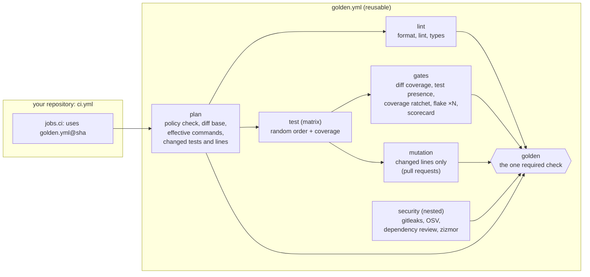

# Architecture

## Job graph



- `plan` runs first and is cheap (about 20 s). Everything else fans out from it.
- `lint` and `test` run in parallel; `gates` and `mutation` wait for the coverage report from
  `test`.
- `security` is a nested reusable workflow (`$/.github/workflows/security.yml`), so it can also
  be used on its own.
- The final `golden` job `needs` every other job with `if: always()`. It fails when any job
  failed or was cancelled. Skipped jobs are fine: for example, `mutation` is skipped on pushes and
  when no source lines changed. Because a skipped *upstream* job always comes with a failed one,
  nothing slips through.

## One version for YAML and logic

Reusable workflows usually ship shell snippets or download a separately versioned tool, and the
two drift apart. Here the gate logic is a Python package (`src/golden`) inside the same repository.

`actions/setup` is a composite action referenced with the 2026 self-repository syntax,
`uses: $/actions/setup`. It resolves to *this repository at the commit the caller pinned* and
installs the CLI from its own checkout:

```yaml
- name: Install golden CLI
  env:
    GOLDEN_SRC: ${{ github.action_path }}/../..
  run: uv tool install --python 3.13 "$GOLDEN_SRC"
```

When a consumer pins `golden.yml@<sha>`, that one SHA freezes the YAML, the default commands
(defined in `src/golden/plan.py`), the thresholds' floors and the gate algorithms. A Dependabot
bump of that SHA upgrades all of them together and shows the whole diff in one PR.

## Where defaults live

Language defaults are data in `src/golden/plan.py`, not conditionals in YAML. `golden plan`
merges them with the caller's inputs (`toJSON(inputs)`) and writes the effective values as job
outputs:

| Input empty? | Effective value |
|---|---|
| yes | language default, e.g. `uvx ruff@0.17.0 check --output-format=github .` |
| no | the caller's command, verbatim |

This makes the defaults reviewable, versioned and unit-tested (`tests/test_plan.py`). It also
means a team can replace any step (for example `test-command: make test`) without forking.

Commands talk to the gates through environment variables, never template expansion inside
`run:` (which zizmor flags as injection-prone):

| Variable | Set for | Meaning |
|---|---|---|
| `GOLDEN_TESTS` | flake command | changed test files (space-separated) |
| `GOLDEN_TEST_PACKAGES` | flake command | packages of changed tests (`./pkg`, for Go) |
| `GOLDEN_REPEATS` | flake command | `flaky.repeats` from policy |
| `GOLDEN_MUTATE` | mutation command | changed functions (mutmut) or `file:start-end` ranges (Stryker) |
| `GOLDEN_BASE` | mutation command | the diff base commit |

Flake and mutation commands run with `bash -o noglob`, so mutmut patterns such as
`pkg.mod.x_func__mutmut_*` reach the tool unexpanded.

## The diff base

| Event | Base | Diff-based gates |
|---|---|---|
| `pull_request` | `pull_request.base.sha` | all |
| `merge_group` | `merge_group.base_sha` | diff coverage, ratchet and flake gate. Test presence and mutation already ran on the PR, and the opt-out label lives on the PR. |
| `push` to the default branch | none | none. The ratchet *saves* a new baseline instead. |

Every diff uses `base...HEAD` (merge-base semantics) with `--relative`, so a project in
`services/api/` sees only its own files. Annotations are rewritten back to repository-relative
paths so they land on the right line in the PR.

## Data flow between jobs

| Data | Producer | Consumer | Mechanism |
|---|---|---|---|
| Coverage report | `test` (newest version in the matrix) | `gates` | artifact `golden-coverage-<slug>`, kept 7 days |
| Default-branch coverage baseline | `gates` on push to the default branch | `gates` on PRs | Actions cache key `golden-baseline-<slug>-<sha>`, restored by prefix |
| Effective commands, changed files | `plan` | all jobs | job outputs |

The baseline uses the cache rather than a committed file. A committed baseline needs a bot with
write access and causes merge conflicts. PRs can read caches written on their base branch, but
caches written by PRs are scoped to the PR's own ref and never reach the default branch. If the
cache was evicted (7 days unused), the ratchet reports "no baseline yet" and passes; the next
push to the default branch restores it.

## Language specifics

| | Python | Node | Go |
|---|---|---|---|
| Toolchain | uv (pinned 0.13.1), Python from the matrix | Node from the matrix, package manager from the lockfile | `go.mod` |
| Install | `uv sync --locked` | `npm ci --ignore-scripts` (pnpm/yarn/bun equivalents) | `go mod download` |
| Coverage format | Cobertura (coverage.py) | Cobertura (v8 provider) | coverprofile → Cobertura (gocover-cobertura) |
| Mutation scope | changed **functions** → mutmut names | changed **line ranges** → `stryker --mutate file:a-b` | whole module, then `golden mutation --base` keeps changed lines |
| Mutation report | `mutants/mutmut-cicd-stats.json` | `reports/mutation/mutation.json` | `gremlins.json` |

Why Go mutates the whole module: gremlins' own `--diff` matches no files when the module lives in a
subdirectory of the repository. We verified this in a drill. Filtering the full report by changed
lines works in any layout, at the cost of mutation time on large modules.

## Decisions and their alternatives

| Decision | Alternative considered | Why |
|---|---|---|
| One `golden.yml` with `language:` | one workflow per language | One required check name, one place to fix bugs. Language differences are data in `plan.py`. |
| CLI in Python | bash in YAML | Testable (230 tests, mutation-tested), typed, cross-language |
| Fail closed | warn on tool errors | A crashed mutation tool or a missing report must never read as "no mutants" |
| Floor + expiring waivers | free-form thresholds | Teams can tighten freely; loosening is visible, justified and temporary |
| Stryker's score formula everywhere | each tool's own (gremlins "efficacy" excludes timeouts) | Same number means the same thing in every language |
| Timeouts count as detected, unless most mutants time out | always detected | A miscalibrated timeout otherwise passes a run that tested nothing; seen with gremlins |
| `ubuntu-24.04` pinned | `ubuntu-latest` | `ubuntu-latest` moved to 26.04 during October–November 2026; image changes should be deliberate |
